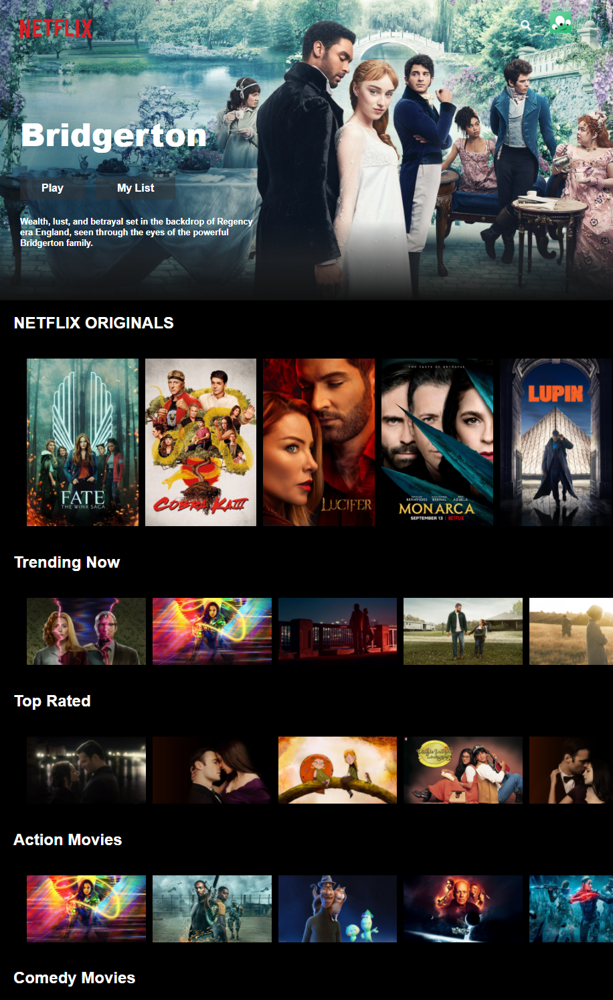
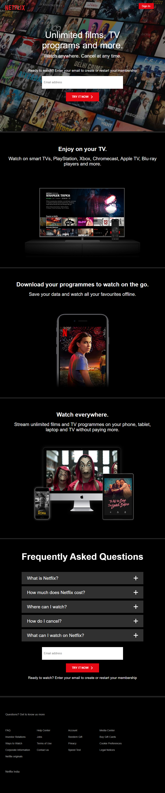
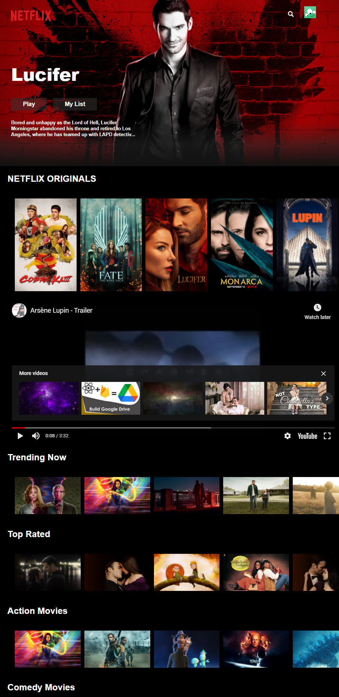

The stack that is being used: React (custom hooks, context, portals), Firebase (Firestore/auth), Compound & Styled components!

Hey! I finally finished this Netflix clone (took me more time than I expected 😅). My idea was to make everything static (movies, series, tv shows, ...) but then I found this really cool TMDB API which you can pull most popular movies, top rated shows, what's trending, collections, lists and muuuch more. Really worth checking the effort made.

Sign-in and the movie rows need your own Firebase project and a TMDB API key. See [Environment variables](#environment-variables).





With Youtube Trailers Embeded




# Getting Started with Create React App

This project was bootstrapped with [Create React App](https://github.com/facebook/create-react-app).

## Environment variables

Copy [`.env.example`](.env.example) to `.env` in the project root and replace the placeholders with your own Firebase web config and TMDB API key. Create React App only exposes variables that start with `REACT_APP_`. Do not commit `.env`.

`src/lib/firebase.prod.js` reads the Firebase values, and `src/request.js` reads `REACT_APP_TMDB_API_KEY`.

| Variable | Maps to |
| --- | --- |
| `REACT_APP_FIREBASE_API_KEY` | Firebase `apiKey` |
| `REACT_APP_FIREBASE_AUTH_DOMAIN` | Firebase `authDomain` |
| `REACT_APP_FIREBASE_PROJECT_ID` | Firebase `projectId` |
| `REACT_APP_FIREBASE_STORAGE_BUCKET` | Firebase `storageBucket` |
| `REACT_APP_FIREBASE_MESSAGING_SENDER_ID` | Firebase `messagingSenderId` |
| `REACT_APP_FIREBASE_APP_ID` | Firebase `appId` |
| `REACT_APP_TMDB_API_KEY` | `api_key` on each TMDB request in `src/request.js` |

## Install

`package.json` `scripts` are `start`, `build`, `test`, and `eject` (`react-scripts` for each). There is no install script. From the project root:

```bash
npm install
npm start
npm run build
```

`npm install` installs the dependencies those scripts need. `npm start` runs the app, and `npm run build` creates the production build. Both are described under [Available Scripts](#available-scripts).

## Available Scripts

In the project directory, you can run:

### `npm start`

Runs the app in the development mode.\
Open [http://localhost:3000](http://localhost:3000) to view it in the browser.

The page will reload if you make edits.\
You will also see any lint errors in the console.

### `npm test`

Launches the test runner in the interactive watch mode.\
See the section about [running tests](https://facebook.github.io/create-react-app/docs/running-tests) for more information.

### `npm run build`

Builds the app for production to the `build` folder.\
It correctly bundles React in production mode and optimizes the build for the best performance.

The build is minified and the filenames include the hashes.\
Your app is ready to be deployed!

See the section about [deployment](https://facebook.github.io/create-react-app/docs/deployment) for more information.

### `npm run eject`

**Note: this is a one-way operation. Once you `eject`, you can’t go back!**

If you aren’t satisfied with the build tool and configuration choices, you can `eject` at any time. This command will remove the single build dependency from your project.

Instead, it will copy all the configuration files and the transitive dependencies (webpack, Babel, ESLint, etc) right into your project so you have full control over them. All of the commands except `eject` will still work, but they will point to the copied scripts so you can tweak them. At this point you’re on your own.

You don’t have to ever use `eject`. The curated feature set is suitable for small and middle deployments, and you shouldn’t feel obligated to use this feature. However we understand that this tool wouldn’t be useful if you couldn’t customize it when you are ready for it.

## Learn More

You can learn more in the [Create React App documentation](https://facebook.github.io/create-react-app/docs/getting-started).

To learn React, check out the [React documentation](https://reactjs.org/).

### Code Splitting

This section has moved here: [https://facebook.github.io/create-react-app/docs/code-splitting](https://facebook.github.io/create-react-app/docs/code-splitting)

### Analyzing the Bundle Size

This section has moved here: [https://facebook.github.io/create-react-app/docs/analyzing-the-bundle-size](https://facebook.github.io/create-react-app/docs/analyzing-the-bundle-size)

### Making a Progressive Web App

This section has moved here: [https://facebook.github.io/create-react-app/docs/making-a-progressive-web-app](https://facebook.github.io/create-react-app/docs/making-a-progressive-web-app)

### Advanced Configuration

This section has moved here: [https://facebook.github.io/create-react-app/docs/advanced-configuration](https://facebook.github.io/create-react-app/docs/advanced-configuration)

### Deployment

This section has moved here: [https://facebook.github.io/create-react-app/docs/deployment](https://facebook.github.io/create-react-app/docs/deployment)

### `npm run build` fails to minify

This section has moved here: [https://facebook.github.io/create-react-app/docs/troubleshooting#npm-run-build-fails-to-minify](https://facebook.github.io/create-react-app/docs/troubleshooting#npm-run-build-fails-to-minify)
